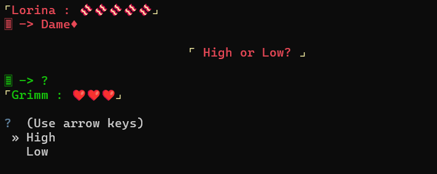

# Lorina Card Game

A terminal card game where you face Lorina in a round of **High or Low**. *Unofficial fan project, inspired by* Black Souls II.

One card is face up, the other is face down: guess whether the hidden card is **higher (High)** or **lower (Low)**.

- A correct guess makes Lorina lose a strip of bacon (she has 5).
- A wrong guess costs Grimm — that's you — a life (you have 3).
- On a tie, you play again.

When Lorina runs out of bacon, you can choose to keep going… or give her a headpat (literally). If you lose all three lives, she won't go easy on you.



## Features

- arrow-key menus (`questionary`) and colors (`colorama`);
- Lorina's lines typed out letter by letter, with different reactions depending on how the game is going;
- an **image displayed in the terminal** for the "Good" ending (`climage`);
- cancelling a menu mid-game is handled gracefully instead of crashing.

## Install and run

Requirements: **Python 3.8 or later** (tested with Python 3.12) and a terminal that displays emojis, such as Windows Terminal.

```bash
pip install -r requirements.txt
python CodeFile/LorinaCardGame.py
```

You can also double-click `launch.bat` (Windows) or run `launch.sh` (macOS and Linux). Make the terminal window large enough for the ending image to fit.

## Project structure

```
.
├── CodeFile/
│   ├── LorinaCardGame.py     Start menu and game loop
│   ├── LorinaFunction.py     Game rules: wins, losses, endings
│   ├── LorinaUi.py           Display and typewriter effect
│   ├── LorinaDialogue.py     Lorina's lines
│   └── LorinaLibrary.py      Game state and card lists
├── image/                    "Good" ending illustration
└── launch.bat, launch.sh     Launchers

```

## Credits

- "Good" ending illustration: by [@xunlin123](https://www.pixiv.net/en/users/93392103) on Pixiv. Used here non-commercially; removal on request.
- **Unofficial** fan project, not affiliated with the authors of *Black Souls*. The code is original; the lines are inspired by those of the game and adapted for this project.

## License

© 2026 Trilord1234. All rights reserved, except third-party resources (illustration: see Credits, which remains the property of its author).
This repository is public for viewing. Any reproduction, modification or redistribution requires the author's written permission.
Third-party resources will be removed on request.
